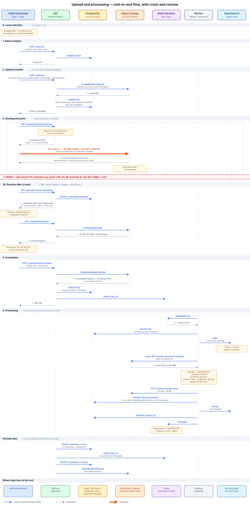
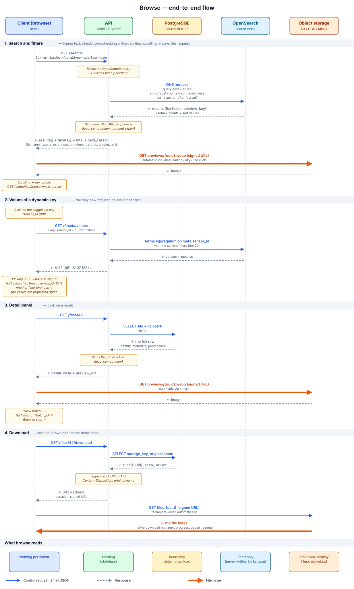
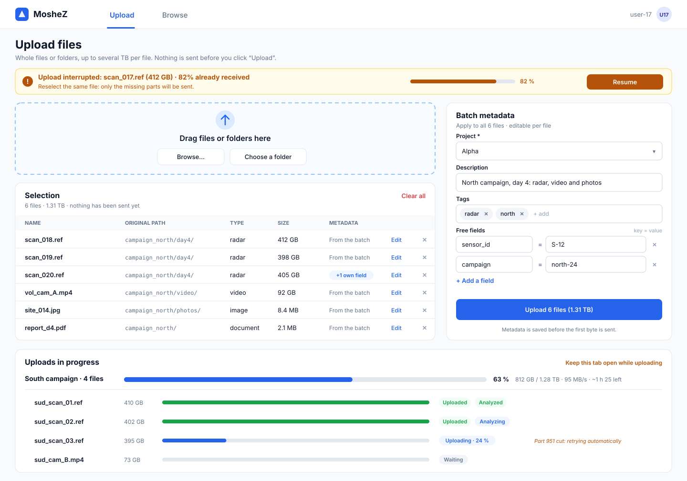
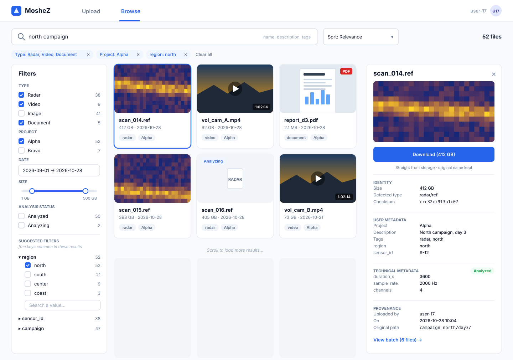

# Design details

This document contains the full detail of the design. The summary requested by the assignment (architecture overview, chosen tools, key decisions) and the mockups are in the **[README](README.md)**.

**Outline:**
1. [Assumptions](#assumptions) and [requirements](#requirements--decisions)
2. [Upload end-to-end flow](#upload-end-to-end-flow): client, API, database, processing, storage, importing existing data
3. [Browse end-to-end flow](#browse-end-to-end-flow): search, filters, detail panel, download, degraded modes
4. [UI design of the Upload and Browse pages](#ui-design-of-the-upload-and-browse-pages): each element on the screen and the decision it illustrates

# Assumptions

1. The target storage uses an S3-compatible API, whether it is in the cloud or on-prem.
2. The main flow is uploading new files through the UI. Existing data is imported by a server-side admin job that reuses the same processing pipeline.
3. "Logical browsing" means organizing by metadata, decoupled from the physical path.
4. Scale is measured in number of files and in individual file size, more than in total volume.
5. The assignment does not mention access rights: all authenticated users see all files. If needed, the API adds a mandatory access filter to every search, without changing the rest of the design.

# Requirements & decisions

## 1. Uploads need to be reliable and support terabytes-scale

- **A single mechanism for one file or a batch.** A drop zone accepts one or more files.
- **No RAM problem.** The browser only keeps references to the files. It reads them chunk by chunk (`file.slice`).
- **Multipart upload.** Each file is split into parts, sent in parallel. On failure, only the affected part is sent again.
- **Adaptive part size.** S3 accepts at most 10,000 parts, so parts must be at least ~100 MB for a 1 TB file.
- **Direct upload to storage through presigned URLs.** The backend only drives the upload, without receiving the bytes. So it does not become the bottleneck.
- **Resume after a crash.** The parts already received stay in storage, attached to the `uploadId`. Since they are sent in parallel, there is no single offset: the state is the set of received parts. It is split across two sources:
  - **Our DB knows which upload to resume:** `uploadId`, part size, file fingerprint (name + size + modification date).
  - **Storage knows which parts it has received** (`ListParts`). We do not copy this state into the DB, to avoid 10,000 writes and any divergence.
  - After a crash, the user selects the file again. The client checks the fingerprint, asks for the received parts and sends only the missing ones. A part interrupted mid-send is sent again in full.
- **Visible progress** for each file and for the whole batch.
- **Integrity.** The client sends a CRC checksum with each part, and storage checks it on receipt. At `complete`, storage combines these CRCs to get the checksum of the whole file, without reading it again. This checksum is saved in the DB (see *File processing*).
- **Cleanup of abandoned uploads.** A backend job aborts sessions stuck for more than N days. It complements the storage's native rule (S3 or GCS lifecycle, MinIO expiration).

## 2. Data is highly diverse (docs, images, videos, radar files etc.)

- **The core does not depend on any format.** Storage and the catalog treat all files the same way. Only extractors and previews are format-specific.
- **Cascading type detection:** magic bytes → extension → user-declared type → `unknown`.
- **An inconsistency is flagged, not rejected** (for example an extension that contradicts the magic bytes).
- **A file of unknown type stays stored, searchable and downloadable.**

## 3. Users need to be able to attach metadata to their files at upload time

- **Hybrid model:** a few common fields (project, description, tags) + free key/value pairs.
- **Structured fields feed the browse filters.** Free keys/values remain searchable.
- **Entered at the batch level,** with the option to edit file by file.
- *Later:* templates per data type (for example "Radar recording").

## 4. The system needs to automatically enrich the uploaded files with technical metadata where possible

- **Two layers:** universal metadata for all files (size, checksum, type, date, uploader), and type-specific metadata (EXIF, video duration, number of pages…).
- **"Where possible" = best effort.** An unknown format or a crashing extractor never makes the upload fail. The status then shows `skipped` or `failed`.
- **Asynchronous processing, after the upload.**
- **A registry of extractors indexed by type.** Supporting a new format means adding an extractor.
- **On large files, we only read the header** (range request), without downloading the whole file.
- **Technical metadata is kept separate from user metadata,** so that the user cannot overwrite it.

# Upload end-to-end flow



## 1. Client: the web browser

**What:** **the client is the user's web browser.** It runs a web application (SPA) in React + TypeScript, with two pages: Upload and Browse. In the diagrams, it appears under the name **"Client (browser)"**.

**How the application reaches the browser:** its files (HTML, JS, CSS) are plain static files, served by a CDN or a web server (nginx). After that, the browser only talks to the API (over HTTPS, JSON) and to storage (over HTTPS, through presigned URLs).

**Why the web:**
- The assignment asks for UI pages.
- There is nothing to install: you open a URL.
- The browser can read a file in chunks, send requests in parallel and accept dropping a whole folder.
- *Rejected alternative:* a desktop app (Electron). It would allow resuming without selecting the file again and closing the tab, but it would have to be installed and maintained. It is the natural evolution if multi-TB uploads become the norm, and the backend would stay the same.

**How an upload works:**
1. **Local selection.** Dropping adds the files or folders to an in-memory list in the browser. No network call happens at this stage. The user can add or remove files, and the original relative path is kept as metadata.
2. **Metadata.** The user enters it at the batch level, then can edit it file by file.
3. **Upload button.** Sending only starts at that moment. This way, metadata is entered before sending (that is the requirement) and a wrong 2 TB folder is not sent by mistake.
4. **Sending.** Uppy splits each file and sends the parts in parallel, directly to storage. It handles retries, progress per file and for the batch, and resume.
5. **Closing the tab.** A warning is shown if an upload is in progress.

**Uppy:**
- **What:** an open source JS library that acts as the upload engine. It runs inside our app and is neither a service nor a server.
- **How:** we give it functions that call our API (create the upload, sign a part, list the parts, complete, abort). Uppy sends the bytes to storage, and our API issues the authorizations and keeps the registry.
- **Why:** it implements exactly our scheme (multipart + presigned URLs + direct upload). Retries, concurrency and resume are tricky to code yourself.
- *Rejected alternatives:* a home-made solution (too much logic to write), tus (the bytes go through a server), the AWS SDK (credentials in the browser, and tied to AWS), react-dropzone (UI only)


## 2. API backend

**What:** an HTTP service in Python + FastAPI. It is the **control plane**: it issues authorizations, keeps the registry in the DB and drives storage. **It never receives the content of the files,** only small JSON requests.

**Why Python + FastAPI:**
- **A single language for the API and the workers.** The extraction and preview tooling is in Python or is easy to call from Python (PyExifTool, Pillow, PyMuPDF, ffmpeg, numpy/h5py for domain formats), and we share the same data model as well as the same DB and storage access code.
- **FastAPI** is asynchronous, so it suits many small concurrent requests. It automatically validates incoming metadata (Pydantic) and generates the API documentation (OpenAPI).
- *Rejected alternative:* Node/NestJS. We would have a single language with the front end, but two languages as soon as we write the workers.

**Upload endpoints:**
| Endpoint | Role |
|---|---|
| `POST /batches` | Creates the batch with its metadata |
| `POST /uploads` | Creates the file in the DB (`uploading`) and opens the multipart upload on storage → `uploadId` |
| `GET /uploads/{id}/parts/{n}/sign` | Returns a presigned URL for part N, computed locally without calling storage |
| `GET /uploads/{id}/parts` | Lists the received parts (`ListParts` on storage), for resume |
| `POST /uploads/{id}/complete` | Assembles the object, sets the status to `uploaded` and publishes "file ready" |
| `DELETE /uploads/{id}` | Aborts the upload |
| `GET /uploads?status=uploading` | Lists interrupted uploads, to offer resume |

**How:**
- **A single file is a batch of one file.** The batch matches one click on "Upload" and carries the common metadata. This gives a single model and a single code path, and the UI does not show the word "batch" for a single file.
- **User metadata is validated and saved as early as `POST /uploads`,** before the first byte. It is not lost in a crash, and an error is reported right away rather than after 1 TB.
- **Small files** (under ~100 MB) **are sent in a single presigned PUT,** without multipart, and always directly to storage.
- **Presigned URLs are limited** to a single part and to a lifetime of about 1 h. The client never has the storage credentials.
  - *What a presigned URL is:* a URL to a private object, to which the API adds a **signature** computed with the storage secret key (method, file, date, validity period). Storage recomputes the signature and serves the request only if everything matches. It is like a named ticket: one operation, one file, one time window. *Limit:* whoever holds the URL can use it while it is valid, hence short lifetimes, HTTPS, and no URLs in the logs.
- **The API is stateless.** All state is in the DB or in storage, so we can run several instances behind a load balancer, and a restart does not cut any upload.
- **A periodic cleanup job** aborts uploads left `uploading` for more than N days (`AbortMultipartUpload` + `status=aborted`).
- **The API does not enrich files.** It publishes a message, and the workers do the extraction (see *File processing*).

## 3. Database: PostgreSQL + OpenSearch

**What:** two tools, with two distinct roles.

| | **PostgreSQL** | **OpenSearch** |
|---|---|---|
| Role | **Source of truth** | **Search index** (a copy optimized for reading) |
| Contains | Batches, files, upload state, metadata | One document per uploaded file, with its metadata |
| Who writes | API (upload), worker (enrichment) | Worker only, from Postgres |
| Who reads | API (resume, cleanup, file detail) | Browse page (search + facets) |
| If we lose it | Serious: it is the truth | Not serious: we rebuild it from Postgres |

### PostgreSQL: the source of truth

**Why Postgres rather than MongoDB:**
- **Our data is mostly structured and relational.** A batch has files; a file has a status, an `uploadId`, a part size. Only part of the metadata is variable.
- **This variable part fits in JSONB columns** (free JSON stored in a column). So we get Mongo's flexibility where we need it, and regular columns everywhere else. This is exactly our hybrid metadata model.
- **Transactions protect the upload state.** Example: the user completes an upload at the moment the cleanup job aborts it. `UPDATE ... SET status='uploaded' WHERE id=42 AND status='uploading'` guarantees that only one of the two operations succeeds.
- **Constraints guarantee consistency, whatever the code does:** no file without a batch (foreign key), and a status limited to `uploading`, `uploaded` or `aborted`.
- *MongoDB would be the right choice if* almost all the data were variable and unrelated. That is not our case.

**Schema:**
```
batches (id, project, description, tags[], created_by, created_at)

files   (id, batch_id → batches,
         name, size, mtime, relative_path,            -- fingerprint + origin
         status, upload_id, part_size, storage_key,   -- upload tracking
         detected_type, checksum, enrichment_status,  -- checksum: API · the rest: worker
         preview_key,                                 -- preview generated by the worker (NULL if none)
         user_metadata JSONB, tech_metadata JSONB,    -- free / technical metadata
         created_by, created_at, updated_at, indexed_at)
```

**Indexing:** an index is a structure that finds rows without scanning the whole table. **In Postgres, we only index what the API needs,** not the browse:
| Index | Used to |
|---|---|
| `files(batch_id)` | List the files of a batch |
| `files(upload_id)` unique | Find a file from an upload |
| `files(created_by) WHERE status='uploading'` (partial index) | Show "my interrupted uploads" for resume |
| `files(created_at) WHERE status='uploading'` (partial index) | Let the cleanup job find uploads that are too old |
| `files(updated_at) WHERE indexed_at IS NULL OR indexed_at < updated_at` (partial index) | Let the reconciliation job find files to reindex |

There is **no index on the JSONB columns**: metadata searches go through OpenSearch. A partial index only contains the relevant rows. So it stays small, even with millions of files.

### OpenSearch: the search index

**What:** an open source, distributed search and analytics engine. It stores JSON documents and builds an **inverted index**, which maps each word or value to the list of documents that contain it (like the index at the end of a book). It is built for text search, combined filters and counts (aggregations) on large volumes.

**Why:** browse is one of the two pillars of the assignment, and its queries are the ones where Postgres is weak:
- facets with counts on **dynamic** fields (`sensor_id`, `campaign`…);
- good-quality text search: typo tolerance, relevance, highlighting;
- text + filters + counts combined in **a single fast query**.

It is **the type of queries** that justifies OpenSearch, more than the volume.

**Elasticsearch or OpenSearch?** They are almost the same product. OpenSearch is the open source fork (Apache 2.0 license) and exists as a managed service on AWS. Elasticsearch is fine if the organization already has an Elastic license or support.

**The indexed document (one per file):**
```json
{ "id": 42, "name": "scan_001.ref", "description": "North campaign, day 3",
  "batch_id": 7, "project": "Alpha", "tags": ["radar", "north"], "detected_type": "radar/ref",
  "size": 412000000000, "created_at": "2026-10-28T10:00:00Z", "created_by": "user-17",
  "user_metadata": { "sensor_id": "S-12", "campaign": "north-24" },
  "tech_metadata": { "duration_s": 3600, "sample_rate": 2000 },
  "metadata_keys": ["sensor_id", "campaign"],
  "preview_key": "previews/0193a7c2….webp" }
```

**Indexing (the mapping, that is, the type of each field):**
| Type | Fields | What it enables |
|---|---|---|
| `text` | `name`, `description` | Full-text search: splitting into words, lowercasing, stemming ("radars" finds "radar") |
| `keyword` | `batch_id`, `project`, `tags`, `detected_type`, `created_by` | Exact filters and **facets with counts** |
| `date` / numeric | `created_at`, `size`, `duration_s`… | Range filters ("since January", "> 1 GB") and sorting |
| Dynamic | `user_metadata.*` | **Any new key is indexed automatically,** and **all values are indexed as `keyword`, even numbers.** A user who writes `altitude: 1200` and another who writes `altitude: "high"` therefore never create a type conflict, and no document is rejected. *Limit:* exact-value filters only (see *Browse → Filters*) |
| Dynamic | `tech_metadata.*` | Indexed with their natural type (numbers, dates), because the extractor produces them, consistently |
| `keyword` | `metadata_keys` | The list of the file's free keys: used for **suggested filters** (see *Browse → Filters*) |

*Safeguard:* we limit the total number of fields, to prevent a user from creating thousands of different keys and blowing up the mapping.

### Why keep the data twice

- **No tool does both well.** Postgres is built to write reliably and consistently, OpenSearch to search fast. Putting them together gives the best of both.
- **We only duplicate the metadata** (a few KB per file), not the files. Even with millions of files, that stays at a few GB.
- **The copy goes in one direction only:** Postgres → OpenSearch. Nobody writes directly to OpenSearch, so there is never a conflict to resolve. The index is derived data, which can be rebuilt at any time.

### Synchronization and crash cases

**The principle:**
1. The worker writes to Postgres, then indexes the document in OpenSearch with `id = file.id`. Reindexing simply overwrites the old document, without creating a duplicate: the operation is **idempotent**.
2. It then updates `indexed_at` in Postgres.
3. **A periodic reconciliation job** reindexes all files where `indexed_at < updated_at`. It is the safety net that covers all the cases below.

| Failure | Consequence | Resolution |
|---|---|---|
| **The worker crashes** between the Postgres write and the indexing | The file exists but does not appear in browse | The message was not acknowledged: another worker picks it up (`XAUTOCLAIM`). Otherwise, the reconciliation job reindexes it (see *File processing*) |
| **OpenSearch is unavailable** | Browse is degraded. **Upload keeps working** (it does not depend on OpenSearch) | The worker retries with an increasing delay, then reconciliation catches up |
| **The index is lost, corrupted, or its mapping must change** | Search is wrong or empty | Full reindex from Postgres into a new index, then an alias switch (the name the app uses points to the new index), with no downtime |
| **Postgres is unavailable** | Uploads cannot start (the API returns 503 and Uppy retries). **Browse still works**, read-only, through OpenSearch | Postgres as a managed service (RDS or Cloud SQL), with a replica and continuous backups (point-in-time recovery) |
| **Metadata is modified later** | The index is no longer up to date | Same path: we update Postgres (`updated_at`), then reindex |

## 4. File processing: Redis Streams + workers

**What:** at the end of an upload, the API publishes a message to Redis Streams. **Python workers** consume it: they detect the file type, extract the technical metadata, write it to Postgres and index the file in OpenSearch.

**Why separate, asynchronous processing:** a slow or crashed extraction never slows down the API or the user. We simply increase the number of workers if the queue grows.

### The message: an identifier, not the metadata
```json
{ "file_id": 42 }
```
- **Postgres remains the only source of truth.** The worker reads everything it needs from it. If the user edits their metadata in the meantime, the message does not contain a stale copy.
- **Messages stay tiny** (~100 bytes): one million pending messages represent ~100 MB of RAM.

### Redis Streams: the task queue

**What:** a Redis stream is a log of messages. A **consumer group** delivers each message to a single worker of the group. A message that was taken but not yet acknowledged stays in the **PEL** (*Pending Entries List*), which allows it to be redelivered if its worker dies.

**Why Redis Streams:**
- **Open source, no vendor lock-in.** It runs in the cloud as well as on-prem (consistent with assumption 1).
- **Durable:** with `appendfsync always`, each write is on disk before it is confirmed.
- **At-least-once:** a message is only deleted once acknowledged, and it is redelivered if its worker dies.
- **Dead-letter queue** thanks to the delivery counter.
- **A pattern already implemented and proven** on a distributed crawler (consumer groups, `XAUTOCLAIM`, DLQ, AOF `always`).
- *Rejected alternatives:* **SQS** (tied to AWS), **RabbitMQ** (same native guarantees, but nothing more for our needs), **Kafka** (a log with offsets: a slow file blocks its whole partition, and it is sized for millions of events per second, which would be over-engineering for a few thousand files per day).

**How (lifecycle of a message):**
| Step | Redis command |
|---|---|
| The API publishes after `complete` | `XADD files_to_process { file_id }` |
| A worker takes a message | `XREADGROUP` (consumer group `workers`) |
| The work is done | `XACKDEL`: acknowledgment and deletion, atomically |
| The worker is dead (message idle for more than N min) | `XAUTOCLAIM`: another worker picks it up |
| Failure on every attempt (3 deliveries) | `XPENDING` gives the counter → message copied to the `files_dead_letter` stream, acknowledged, and `enrichment_status = failed` |

### The worker, step by step
1. **It takes a message** and reads the file from Postgres (storage key, user metadata).
2. **It immediately indexes** the file in OpenSearch with `enrichment_status: pending`. The file appears in browse within a few seconds, with an "Analyzing" badge.
3. **It detects the type:** it reads the first bytes (range request), then applies the cascade magic bytes (`libmagic`) → extension → declared type → `unknown`.
4. **It runs the metadata extractor** (ExifTool, or a domain extractor), then **the preview generator**. It writes the preview to storage (`previews/{uuid}.webp`, see *Object storage*).
5. **It writes in one Postgres transaction**: `detected_type`, `tech_metadata`, `preview_key`, `enrichment_status` (`done`, `skipped` or `failed`) and `updated_at`.
6. **It reindexes in OpenSearch,** then updates `indexed_at`.
7. **It acknowledges the message** (`XACKDEL`).

**The worker is idempotent:** each step overwrites by `file_id` (`UPDATE` in Postgres, `id = file_id` in OpenSearch). Processing the same message twice gives the same result, which makes at-least-once safe.

### Metadata extractors

**What:** a function that receives access to the file and returns a dictionary of metadata. A **registry** maps each type to its extractor:
```python
EXTRACTORS = {
    "radar/ref": extract_radar,     # domain formats: in-house parser
    "*":         extract_exiftool,  # everything else
}
```

**ExifTool, the main extractor:** an open source tool specialized in metadata for hundreds of formats. It reads EXIF, GPS and dimensions of images; duration, dimensions and codec of videos (MP4, MOV, MKV); page count and author of PDFs; and the properties of Office documents. It reads an input stream, and its `-fast` option keeps it from reading to the end of the file. We call it from Python with **PyExifTool** (a wrapper around the `exiftool` program, installed in the worker's Docker image).

**Why:**
- **A single tool covers all common formats.** We only write dedicated extractors for the **domain formats** that ExifTool does not know (radar). Supporting a new domain format means adding a function to the registry.
- *If the domain needs finer video information* (codec per track, bitrate, frame rate), we add a dedicated extractor with **ffprobe**. This is not needed at the start.
- *Rejected alternative:* **Apache Tika**. It is built to extract the **full text** of documents, and for many formats (PDF, ZIP, Office) it copies the whole file to disk before parsing it. That is incompatible with partial reading.

**Unknown format:**
1. If ExifTool does not recognize the format (*Unknown file type* error), we keep the `libmagic` description (`"HDF5 data"`, `"NetCDF Data Format"`, or `"data"`).
2. **In all cases,** the universal metadata (size, checksum, dates, uploader) is there. The status is `done` if we extracted specific metadata, `skipped` otherwise.

**How, without ever reading a whole file:**
- The extractor receives an **on-demand reader** on storage (range requests), never a downloaded file.
- Metadata is located **at the start of the file** in the vast majority of formats (headers, EXIF). It is sometimes **at the end** (MP4 index, PDF table), which only requires one range request on the end.
- **A budget per extractor:** at most 64 MB read and 60 s, in a subprocess. Beyond that, it stops and the status becomes `skipped`. **This is the concrete definition of "where possible".**
- *Reprocessing:* when we add an extractor, we republish the `file_id`s of the relevant type, and the old files get enriched.

### Preview generators

**Why a separate registry:** ExifTool **reads metadata, but does not decode pixels.** It cannot shrink an image, render a PDF page or extract a frame from a video. Previews therefore need rendering tools, one per family of formats.

**The chain:**
1. **Is a thumbnail already embedded in the file?** (EXIF of camera JPEGs, RAW files, some PDFs and videos.) ExifTool extracts it (`-b -ThumbnailImage` / `-PreviewImage`), without any decoding.
2. **Otherwise, a generator based on the type:**

| Type | Tool | How |
|---|---|---|
| Images | **Pillow** | Reads the header first, decodes directly at low resolution for JPEGs (`draft()`), then `thumbnail()` and WebP |
| PDF | **PyMuPDF** | Renders page 1 (`get_pixmap()`), then WebP |
| Video | **ffmpeg** | `ffmpeg -ss 5 -i "<presigned URL>" -frames:v 1 -vf scale=320:-1`: jumps directly to 5 s with a range request, without reading the rest |
| Radar / domain formats | **numpy + matplotlib** | A *quicklook* (for example the first frame), **if the domain experts define one** |

3. **Otherwise,** no preview: the UI shows a type icon.

**The same safeguards as the extractors:** same read and time budget, and a subprocess. These tools read files supplied by users: the subprocess isolates a crash, and Pillow has native protection against "decompression bombs" (`MAX_IMAGE_PIXELS`). *Evolution:* for very large images (scientific TIFFs of several GB), **pyvips** replaces Pillow, because it processes the image as a stream.

**Everything is in the worker's Docker image:** the Python packages (PyExifTool, Pillow, PyMuPDF, python-magic) and the system programs (exiftool, ffmpeg, libmagic).

### Integrity: a combinable CRC rather than a SHA-256

**The problem:** a SHA-256 is computed by reading every byte, in order, from start to end. It cannot be rebuilt from the parts. For 1 TB, we would therefore have to read everything again (~30 min), either in the browser or in the worker.

**The solution:** a **CRC32C** is *combinable*: the CRC of the whole file is computed from the CRCs of its parts.
1. The client computes the CRC of each part while it reads it to send it, so with no extra read.
2. Storage checks each part on receipt.
3. At `complete`, storage combines these CRCs and provides the checksum of the whole object. The client compares it with its own combination, which gives an **end-to-end check without any re-read**.
4. The API saves this checksum in Postgres.

**The trade-off:** a CRC detects **accidental** corruption (network, disk), but it is not a cryptographic fingerprint. We choose CRC32C because it is **the only CRC available on S3, GCS and MinIO**, and because it matches a value that can be computed on the original file. Our need is integrity, not security.

**If a cryptographic need appears** (legal traceability), we move to a **tree hash** (*Merkle tree*): the SHA-256 of each part, then the SHA-256 of the list of those SHA-256s. It is secure and requires no re-read.
- **S3's composite SHA-256** does this natively. However, it is not the file's `sha256sum` (the value depends on the part size), S3 only accepts one algorithm per upload, and GCS does not offer it.
- *In one line:* **BLAKE3** is a natively tree-based hash, very fast, but no object storage supports it.

### Why extract after the upload, and not in the browser
- **Trust:** *system* metadata must be computed by the system, not by a client that can get it wrong.
- **Tools:** ExifTool, ffmpeg, radar parsers and Python libraries do not exist in a browser.
- **Reprocessing:** to enrich old files with a new extractor, we have to read from storage again. So this path has to exist anyway.
- **Importing existing data** goes through the same pipeline, without a browser.
- **The read cost is negligible:** we only read headers, and storage → worker transfer is free within the same region (it is egress to the internet that costs money).

### Why Postgres remains essential alongside Redis
| Role | Tool | What it keeps |
|---|---|---|
| **Coordination**: the work still to do | Redis Streams | Pending messages, **deleted once processed** |
| **Catalog**: what exists | PostgreSQL | Every file, its status and its metadata, **forever** |
| **Content** | Object storage | The bytes |

- **Redis cannot serve as a catalog:** everything must fit in RAM, and it has no queries, no secondary indexes and no constraints.
- **We cannot write to two systems atomically.** The API does `UPDATE status='uploaded'` (Postgres) then `XADD` (Redis). If it dies between the two, no message exists, even if Redis is perfectly durable. No transaction covers both systems. **Only a source of truth that can be read again lets us recover from this case,** and that is Postgres.

### The reconciliation job (the safety net)
It runs every few minutes and makes two queries:
1. Files `uploaded` that have stayed in `enrichment_status = 'pending'` for more than N minutes → **republished** to Redis (`XADD`).
2. Files where `indexed_at < updated_at` → **reindexed** in OpenSearch.

A duplicate message is not a problem, since the worker is idempotent. *(The more formal alternative is the **transactional outbox** pattern: the message is written to a Postgres table in the same transaction, then a relay pushes it to Redis.)*

### Crash cases
| Failure | Consequence | Resolution |
|---|---|---|
| **The worker dies** during processing | The message stays in the PEL, unacknowledged | `XAUTOCLAIM`: another worker picks it up after N min. Idempotence makes the retry safe |
| **A file crashes the extractor** every time | The message would fail in a loop | After 3 deliveries: DLQ + `failed`. **The file stays visible and downloadable,** without technical metadata |
| **The extractor is too slow or reads too much** | — | The budget cuts it off → `skipped` |
| **The API dies** between `UPDATE uploaded` and `XADD` | No message, the file stays `pending` | Reconciliation republishes it |
| **Redis is unavailable** at `complete` time | The `XADD` fails | **The `complete` still succeeds**, and reconciliation publishes the message later (see below) |
| **Redis crashes** | With AOF `always`, no confirmed message is lost | Redis restarts and the workers resume |
| **Failover to a Redis replica** (replication is asynchronous) | The last messages may be missing | Reconciliation republishes them |
| **Storage is unavailable** during reading | Extraction fails | The message is not acknowledged, so it is retried. After 3 failures: DLQ, and we can **replay the DLQ** once storage is back |
| **Redis has a prolonged outage** | Many files stay `pending` | **An alert fires** when the number of `pending` files exceeds a threshold, so that an outage does not go unnoticed |

### Redis unavailable at `complete`: why the upload still succeeds
At `complete`, the order is: 1. storage assembles the object (irreversible), 2. `UPDATE status='uploaded'` in Postgres, 3. `XADD`, the step that fails.

| | **A. Make the `complete` fail** | **B. Succeed and reconcile later (chosen)** |
|---|---|---|
| What the user sees | "Failed", even though their bytes are stored and intact. They may send 1 TB again for nothing | The truth: their file is stored and downloadable, with the "Analyzing" badge |
| Upload dependency | The upload depends on Redis, which is only used for enrichment | The upload depends only on storage and Postgres |
| Complexity | We must handle a replayed `complete` on an already assembled object | No new mechanism |
| Reconciliation | **Still required** (the API can die between 2 and 3) | Reused as is |
| Cost | — | Enrichment is delayed by a few minutes, which requires monitoring `pending` files |

**The decisive argument:** A adds failure modes without removing reconciliation. **The principle:** a user operation succeeds as soon as its durable part has succeeded (the bytes in storage, the row in Postgres). Side effects (enrichment, indexing) are asynchronous and recoverable.

## 5. Object storage

**What:** the storage of the **bytes**, that is, the original files and their previews. Everything else (metadata, statuses, references) is in Postgres.

### Compatibility: a single API, the S3 one
| Feature we depend on | S3 | GCS | MinIO |
|---|---|---|---|
| Multipart (create / upload part / list parts / complete / abort) | ✅ | ✅ via the XML API, S3-compatible | ✅ |
| Presigned URLs (PUT of a part, GET) | ✅ | ✅ (V4 *signed URLs*) | ✅ |
| Range GET (partial read) | ✅ | ✅ | ✅ |
| CORS (the browser sends directly to storage) | ✅ per bucket | ✅ per bucket | ✅ at the server level |
| CRC32C per part + on the whole object | ✅ | ✅ (its native checksum) | ✅ |
| Cleanup of abandoned multipart uploads | ✅ lifecycle | ✅ lifecycle | ✅ automatic expiration |
| Storage tiers | ✅ | ✅ | ✅ (to another storage) |

- **How:** a small `StorageClient` interface (`create_multipart`, `sign_part`, `list_parts`, `complete`, `abort`, `presign_get`, `range_read`, `put`) with **a single "S3-compatible" implementation**, which covers S3, GCS and MinIO.
- **We choose CRC32C, not CRC64-NVME,** because it is the only CRC available everywhere.
- **We do not depend on storage event notifications** (such as "S3 Event → SQS"). It is the API that publishes to Redis at `complete`. This is what keeps the design portable.
- *Good to know:* in 2025, the vendor of MinIO heavily restricted its open source edition. The S3-compatible on-prem alternative is **Ceph (RGW)**, and the design does not change. *Azure Blob is not S3-compatible: it would need a second implementation of the interface.*

### Key layout: no business meaning
```
bucket datalake-prod
├── files/{uuid}           ← the original, uploaded by the user (from a few KB to several TB)
└── previews/{uuid}.webp   ← the preview (~30 KB), generated by the worker
```
**Why a UUID rather than a mission, a date or a geographic area:**
- **Object storage has no "rename"**: renaming means copying then deleting. With a mission in the key, reassigning a 1 TB file would require copying 1 TB again. With a UUID, it is an `UPDATE` in Postgres.
- **A file belongs to several logical views** (mission, area, sensor), whereas a path only expresses one. Views live in the metadata and in OpenSearch (assumption 3).
- **The original name is kept in Postgres,** not in the key, because it can contain accents, spaces or `/`. On download, the presigned URL sets `Content-Disposition: attachment; filename="…"`, and the user gets back the original name.
- **The load is well spread:** random UUIDs distribute naturally across prefixes.

**The rule:** *the key only contains what is immutable.* The API generates the UUID at `POST /uploads` and saves it in `storage_key`. The `files/` and `previews/` prefixes have an operational meaning (the object type), which is also immutable.

**A single bucket per environment** (prod, staging). No bucket per mission: we would have to manage multiplied access policies, and moving a file to another mission would imply a copy. *Exception:* if the business requires different **sensitivity or retention** classes, we create one bucket per class.

### Previews
- **What:** a small image file, generated **only once** by the worker during processing. Its key is saved in `preview_key` (Postgres), and OpenSearch receives the same key (`preview_key`).
- **Why pre-generated (eager):** they are shown in the results list, for dozens of files at a time. Generating them on the fly would require reading the original again on every browse, which is slow, and impossible if the original is archived.
- **Why in storage and not in Postgres:** millions of images would bloat the DB, and every thumbnail would go through the API.
- **Display:** the API returns the results with one presigned GET URL per preview, then the browser downloads them directly from storage (~30 KB each). URLs are signed with a rounded expiration (for example to the hour), so that the same URL is reused and cached by the browser.
- **How:** an embedded thumbnail extracted by ExifTool if one exists, otherwise a generator per type (Pillow, PyMuPDF, ffmpeg, domain *quicklook*), with the **same read budget** as the extractors. Without a preview, the UI shows a type icon (see *File processing → Preview generators*).

### Storage tiers
- **The observation:** browse **never reads the originals**, only Postgres, OpenSearch and `previews/`. Originals are written once then rarely read again, which is the textbook case for tiering.
- **What the design guarantees:**
  - the lifecycle only applies to `files/`, and `previews/` always stays in the Standard tier;
  - extraction and preview happen a few minutes after the upload, so **before** any transition;
  - even in a cold tier, an original remains **fully "browsable"** (metadata and preview).
- **By default:** **S3 Intelligent-Tiering, only on its instant-access tiers** (Autoclass on GCS). Each object is automatically moved to a cheaper tier if it is not read, with no retrieval fees. **Originals therefore always remain immediately downloadable.**
- *Evolution, decided by the business:* **deep archiving** (Glacier) and its durations. We would then have to check that an original is available (`HEAD` request) before downloading it, and offer a restore (several hours) in the UI.

### Security
- **Private bucket,** with public access blocked. The only client access goes through presigned URLs.
- **Encryption at rest** (enabled by default on S3 and GCS; to configure on MinIO).
- *Business option:* versioning or *object lock* (immutability), if accidental deletion or tampering must be impossible.

## 6. Importing existing data

**The context:** tens of TB are already scattered in the current storage (assumption 2).

**How:** a **server-side admin job**, without a browser:
1. it walks the inventory of the existing storage (list of objects or folders);
2. it creates one batch per original folder, and one `files` row per file, with the original path as `relative_path`;
3. it **copies** each file to `files/{uuid}` with a server-side copy (the storage copies it itself, without going through the user's network);
4. it publishes `{ file_id }` to Redis: **the same processing** as for an upload (type, metadata, preview, indexing).

**Why:** a single pipeline for new files and existing data, and the same key rule (UUID) everywhere. The job can be resumed: a file already imported is simply skipped.

# Browse end-to-end flow



## 1. Search and filters

**What:** the user types a query or checks a filter. They receive the list of matching files, the filter counts and one thumbnail per file.

**Why the browser goes through the API and never talks directly to OpenSearch:**
- **Security:** exposing OpenSearch to the browser means exposing the whole cluster. The API can also add a mandatory access filter to every query *(see assumption 5)*.
- **Query control:** the API builds the OpenSearch query from simple parameters. The client cannot send arbitrary or overly expensive queries.
- **Decoupling:** the UI does not know the mapping. We can reindex or change the index structure (alias switch) without touching the front end.

**How (who sends what):**
1. **Browser → API:** `GET /search?q=north&project=Alpha&type=radar&sort=date`
2. **API → OpenSearch: a single query,** which contains the text and the filters (`query`), the facet counts (`aggs`, see step 2), the sort and the pagination.
3. **OpenSearch → API:** the results (only the list fields, including `preview_key`), the total number of results, the facet counts, and the sort values of the last result (used as a cursor). **OpenSearch does not return URLs:** it does not know the storage credentials.
4. **The API completes the response:** for each result that has a `preview_key`, it signs a GET URL to the preview (a local computation, without calling storage), and it builds `next_cursor`.
5. **API → Browser:** `results[]` (id, name, type, size, project, analysis status, `preview_url`), `facets{}`, `total` and `next_cursor`.
6. **Browser → Storage, automatically:** the front end puts each URL in an image, ``. The browser sends the GET to storage by itself when the image comes on screen, and storage returns the thumbnail directly (~30 KB). **The user does not click anything.** A click on a result opens the detail panel (step 3).

**The `GET /search` contract: a closed list of simple parameters**

Each control on the screen matches one parameter. FastAPI validates the parameters (Pydantic) and rejects everything else.

| Parameter | Example | Control in the UI |
|---|---|---|
| `q` | `q=north campaign` | The search bar |
| Fixed filters | `type=radar&type=video`, `project=Alpha`, `tags=north` | The facet checkboxes |
| `batch_id` | `batch_id=7` | The "View batch" link in the detail panel (step 3) |
| Ranges | `date_from=2026-01-01`, `size_min=1GB` | The date picker, the size slider |
| Dynamic filters | `meta.sensor_id=S-12` | "Add a filter" (step 2) |
| `sort` | `relevance`, `date`, `name` or `size` | The sort menu |
| `cursor`, `limit` (100 at most) | — | Infinite scroll |

- **The combination rule:** **AND** between different filters, **OR** between values of the same filter. Example: (radar **or** video) **and** project Alpha.
- **What is forbidden:** sending raw OpenSearch language. Otherwise the client could run scripts, regular expressions or huge aggregations, and bring down the cluster.
- **No file becomes unfindable.** We limit the *shape* of the queries, not what is reachable. Each indexed field has a parameter. A specific file can be found by its exact name, its identifier or its checksum (via `q`), or through its batch.
- *Possible evolution:* for complex combinations ("radar AND (north OR south) AND NOT test"), an "advanced search" mode based on OpenSearch's `simple_query_string`, a syntax that is safe by design.

**Decisions:**
- **Results are lightweight.** The list only receives its fields. The full metadata is only loaded in the detail panel (step 3).
- **Text search covers** the name, the description and the tags (`text` fields: splitting into words, stemming, typo tolerance).
- **Pagination uses a cursor** (`search_after`), not a page number. OpenSearch's classic pagination is limited to 10,000 results and gets slow when going deep. The UI does infinite scroll: when reaching the bottom, it asks again with `cursor=next_cursor`.
- **Browse never reads the originals,** only OpenSearch and `previews/`. This is what makes tiering risk-free (see *Object storage*).
- **Freshness:** a just-uploaded file appears in ~1 s (OpenSearch's refresh interval), with the "Analyzing" badge as long as its status is `pending`.

## 2. Filters: how they work and dynamic key values

**Checking or unchecking a filter simply reruns the search from step 1** (`GET /search` with one more parameter), and OpenSearch returns the new results and the new counts in the same response. This step explains how filters and their counts work. **The only new request is `GET /facets/values`,** when the user opens a dynamic key to see its values.

**What:** the filter column next to the results. Each option shows a count ("Radar (87)"). There are two kinds of filters: **fixed** (always shown) and **dynamic** (the users' free metadata).

### A. Fixed filters
- **What:** filters on fields that all files have: type, project, tags, uploader, date, size, analysis status.
- **How we get the counts:** in the same query as the results (step 1), the API asks OpenSearch how many files there are for each value. This is an **aggregation** (`terms` for values, ranges for date and size).
- **The rule: each filter counts with all the other filters applied, except itself.**
  - *Why:* if the user checks "Radar" and the Type filter is recomputed with itself, Video and Image drop to 0. The user can then no longer add "Video".
  - *How:* Type shows its counts *without* the Type filter, and Project shows its own *with* the Type filter. OpenSearch does this in the same query (`post_filter` + one filter per aggregation).

### B. Dynamic filters (free metadata)
- **The problem:** users invent their own keys (`sensor_id`, `campaign`…). There can be hundreds of them, and we cannot show them all.
- **The solution, in three steps:**
  1. **At indexing time,** the worker adds the list of its keys to the document (`metadata_keys`).
  2. **In each search,** the API also asks OpenSearch which keys are **the most frequent in the current results**. The UI shows them as **suggested filters**: "sensor_id (80), campaign (64)". They depend on the context: when filtering on project Alpha, you see the keys used in Alpha.
  3. **The user clicks on a key.** The front end calls `GET /facets/values?key=sensor_id&<current filters>`, and the API returns its values with their counts: "S-12 (45), S-07 (35)". The user picks a value, and `meta.sensor_id=S-12` is added to the search.
- **Why values are only loaded on click:** computing the values of all keys on every search would be expensive. We only compute what the user opens.

### C. Counts that are always correct
- The counts of fixed filters and suggested keys are recomputed **on every search**.
- Value counts are computed **on click, with the current filters**.
- **If the user changes another filter while a key is open, the front end requests its values again.** We never keep a count computed in an old context. A closed key does not show a count.
- *Nuances:* a file uploaded between two queries can shift a count by one, as in any search engine. On a very large index spread across many shards, OpenSearch's "top N" counts become approximate; at our scale, they are exact.

### D. Limits
- **For free keys, we filter by exact value** (checkboxes), not by range. All free values are indexed as text (see the OpenSearch mapping), so "altitude = 1200" works, but not "altitude > 1000".
  - *Why:* it is the only simple way to guarantee that no document is rejected when two users give different types to the same key.
  - *Evolution:* templates per data type (requirement 3, "later") will declare some keys as numbers or dates, which will make ranges possible.
- **We show the 10 most frequent keys and the 20 most frequent values,** with a small search to find the others.
- *Evolution:* useful technical metadata (video duration, image dimensions) can become **contextual filters**, which only appear if the matching type is selected.

## 3. Detail panel

**What:** the page that opens when the user clicks on a result. It shows everything we know about a file:

| Block | Content |
|---|---|
| **Preview** | The thumbnail, or a type icon if there is no preview |
| **Identity** | Original name, size, detected type (and the inconsistency with the extension if there is one), checksum |
| **User metadata** | The common fields (project, description, tags) and the free keys |
| **Technical metadata** | What the extractor found, and the analysis status (`pending`, `done`, `skipped` or `failed`) |
| **Provenance** | Uploader, date, original relative path, and a **"View batch"** link |
| **Action** | **Download** (step 4) |

**How (who sends what):**
1. **Browser → API:** `GET /files/42`
2. **API → Postgres:** reads the file and its batch, by identifier.
3. **The API signs the preview URL** (a local computation).
4. **API → Browser:** a JSON with all the blocks above and `preview_url`.
5. **Browser → Storage, automatically:** the preview image (``), as in the list.

**Why Postgres here, while the list comes from OpenSearch:**
- **It is the source of truth.** OpenSearch can lag slightly (~1 s, or more if a reindex is waiting for reconciliation). The detail panel always shows the exact state.
- **The detail panel needs everything,** including fields we did not put in OpenSearch.
- **It is the simplest query for a DB:** a primary-key read, instant, even with millions of rows.

**The "View batch" link:** it simply opens the results page filtered (`GET /search?batch_id=7`). We reuse the same list, the same filters and the same thumbnails, without a special screen. It is the natural grouping of an upload session, for example all the files of a radar campaign.

**Choice for simplicity:** a single preview size, the same as in the list.

**Possible evolutions:**
- **Editing metadata from the detail panel.** The mechanism already exists (`UPDATE` in Postgres, `updated_at`, reindexing), but the assignment does not ask for it.
- **A larger preview for the detail panel:** a second size generated in the same worker pass.
- **Showing "Archived" in the detail panel,** if deep archiving is set up (see *Object storage → Tiers*).

## 4. Download

**What:** the user clicks "Download" in the detail panel. It is the **mirror of the upload**: the API issues the authorization, and the bytes go directly from storage to the browser.

**How (who sends what):**
1. **Browser → API:** `GET /files/42/download`
2. **API → Postgres:** reads the storage key and the original name.
3. **The API signs a GET URL** (a local computation), valid for ~1 h, with `Content-Disposition: attachment; filename="scan_001.ref"`.
4. **API → Browser:** a redirect (`302`) to this URL.
5. **Browser → Storage:** the browser follows the redirect by itself and downloads the bytes directly from storage.

**Why:**
- **A redirect rather than a URL returned in JSON:** the browser hands the download to its **native download manager**. We get the progress bar, pause and resume, and streaming writes to disk, without RAM. On the front end, the button is a simple link.
- **`Content-Disposition`:** the file is saved under its **original name**, even though its key in storage is a UUID.
- **The API never sees the bytes,** as with upload. So it does not become a bottleneck, even for a 1 TB file.

## 5. Degraded modes

**The principle:** each part of browse depends on a single component. A failure therefore only turns off the part that depends on it.

| Failure | What no longer works | What still works |
|---|---|---|
| **OpenSearch unavailable** | Search and filters (the UI shows "Search unavailable") | The detail panel and download (Postgres + storage), and upload |
| **Postgres unavailable** | The detail panel, download and upload | Search, filters and thumbnails (OpenSearch + storage) |
| **Storage unavailable** | Thumbnails (the UI shows a type icon instead) and download | Search, filters and the detail panel (the metadata) |
| **Just-uploaded file** | — | It appears in the list in ~1 s, with the "Analyzing" badge. The detail panel, read from Postgres, is already exact |
| **Index lagging** (a reindex is waiting for reconciliation) | The list may show slightly outdated metadata | The detail panel, read from Postgres, always shows the truth. Reconciliation fixes the index within a few minutes |

# UI design of the Upload and Browse pages

**What is delivered:**
- **Two mockups** (images): [docs/ui/upload-page.svg](docs/ui/upload-page.svg) and [docs/ui/browse-page.svg](docs/ui/browse-page.svg), shown below.
- **Two clickable prototypes**: [docs/ui/upload.html](docs/ui/upload.html) and [docs/ui/browse.html](docs/ui/browse.html). Just open them in a browser (double-click), with nothing to install.

**The chosen tool:** static HTML/CSS/JS pages, with no framework. The assignment leaves the choice of tool open ("any designing software"). This format is versioned with the rest of the repo, opens everywhere, and makes it possible to *show* the key interactions (resume after a crash, filter counts) rather than describe them. **These are prototypes, not the application:** the data is fictitious, the upload is simulated and nothing is sent anywhere.

**Each element on the screen matches an architecture decision,** as the tables below detail.

## Upload page



| Screen element | Matching architecture decision |
|---|---|
| **"Upload interrupted… Resume" banner** | Resume after a crash: Postgres knows *which* upload to resume, storage knows *which parts* it has received. The user selects the file again, and its fingerprint is checked |
| **Drop zone** (files or a whole folder) | Local selection: the files stay on disk, without RAM, and the original path is kept as metadata |
| **"Selection" list** (remove, edit) | Nothing is sent before the click. Each file can have its own metadata on top of the batch metadata |
| **Batch metadata** (required project, description, tags, free fields) | Hybrid model: common fields + free key/value pairs, entered once for the whole batch, and validated by the API **before the first byte** |
| **"Upload N files" button** | `POST /batches` then `POST /uploads`: the files are saved in Postgres with the `uploading` status |
| **Uploads in progress** (progress of the batch and of each file, throughput, time remaining) | Uppy: multipart, direct sending to storage through presigned URLs, several files and parts in parallel |
| **"Part N cut: retrying automatically"** | A failure only causes the affected part to be sent again |
| **Uploaded / Analyzing / Analyzed / Not analyzable badges** | Asynchronous, best-effort enrichment (`enrichment_status`): an unknown format never makes the upload fail |
| **"Keep this tab open"** | The browser limitation, accepted (warning when closing the tab) |

**To try in the prototype:** add real files or a folder (only their name and size are read), remove some, edit a file's metadata, add tags and free fields, click "Upload", then **"Simulate a crash"** and **"Resume"**.

## Browse page



| Screen element | Matching architecture decision |
|---|---|
| **Search bar** | The `q` parameter: OpenSearch full-text search on the name, the description and the tags |
| **Sort** | The `sort` parameter (relevance, date, name, size) |
| **Active filter chips** | The `GET /search` parameters: **AND** between different filters, **OR** between the values of the same filter |
| **Fixed filters with counts** (type, project, date, size, status) | OpenSearch aggregations, returned with the results. **Each filter counts without itself**: with Radar checked, Image keeps its count |
| **Suggested filters** (`region`, `sensor_id`, `campaign`…) | The most frequent free keys in the results (`metadata_keys`). Their values are loaded on click (`GET /facets/values`). **Choosing a geographic region** goes through the `region` key, without a map |
| **Results grid and previews** | `preview_key` in OpenSearch, URL signed by the API, image loaded automatically (``). Without a preview: a type icon |
| **"Analyzing" badge** | The file is visible ~1 s after the upload, before enrichment finishes |
| **Infinite scroll** | Cursor pagination (`search_after`) |
| **Detail panel** (right-hand panel) | `GET /files/{id}`, read from Postgres (the source of truth) |
| **"Download" button** | `302` to a signed URL: the download happens directly from storage, under the original name |
| **"View batch" link** | The same results page, filtered by `batch_id` |

**To try in the prototype:** type a search, check and uncheck filters (the counts are recomputed), open a suggested key and search for a value, remove a chip, change the sort, scroll, click on a result, then "View batch" and "Download".

---

← Back to the **[README](README.md)** (overview, tools, key decisions, mockups).
