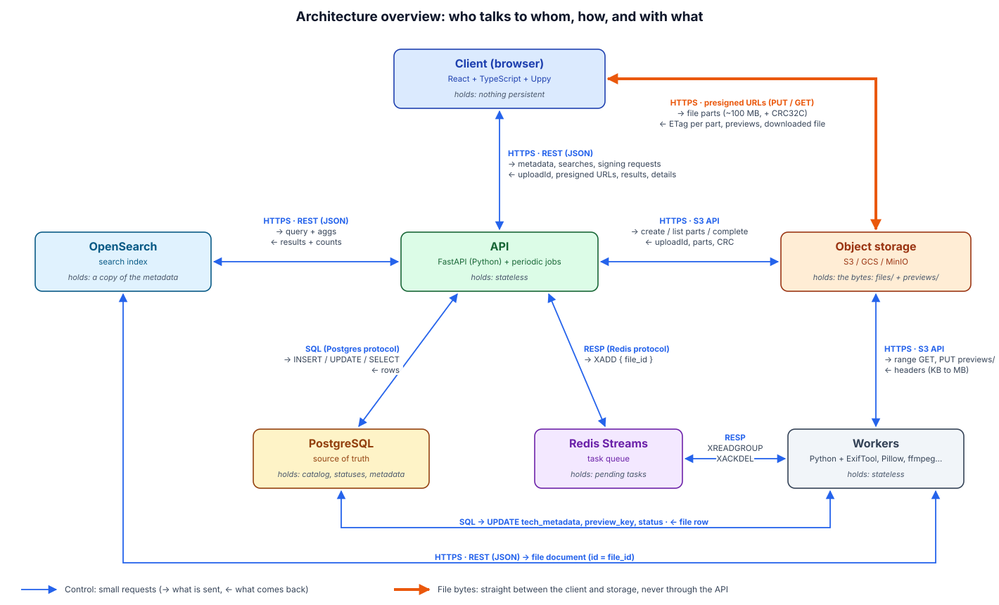
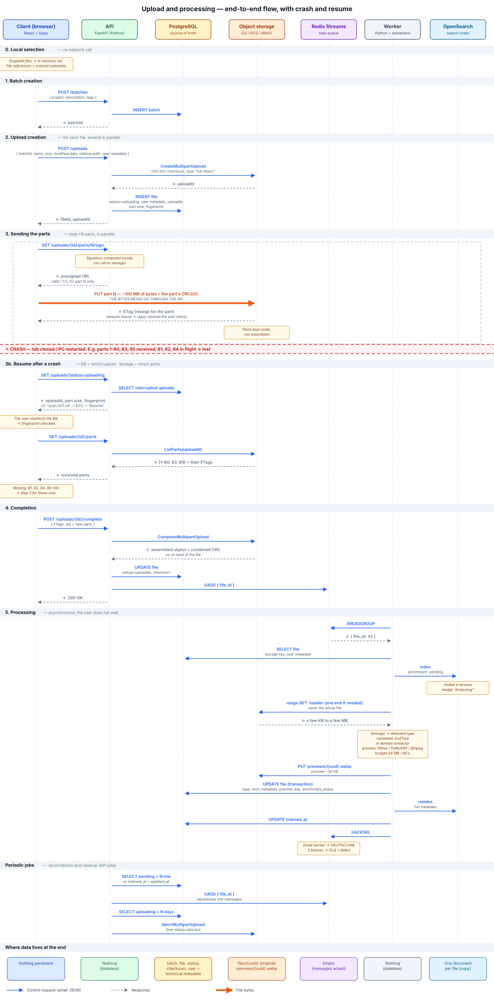
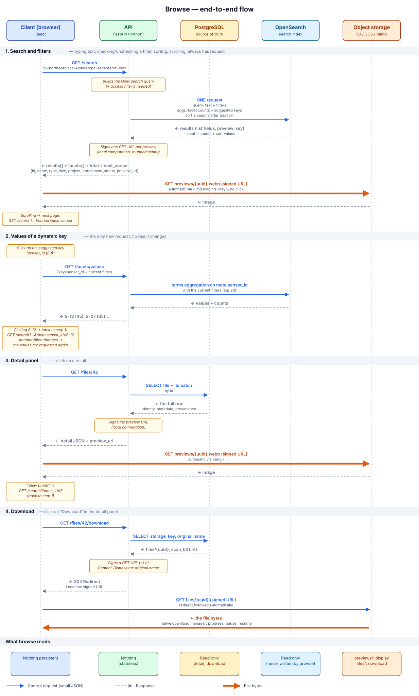
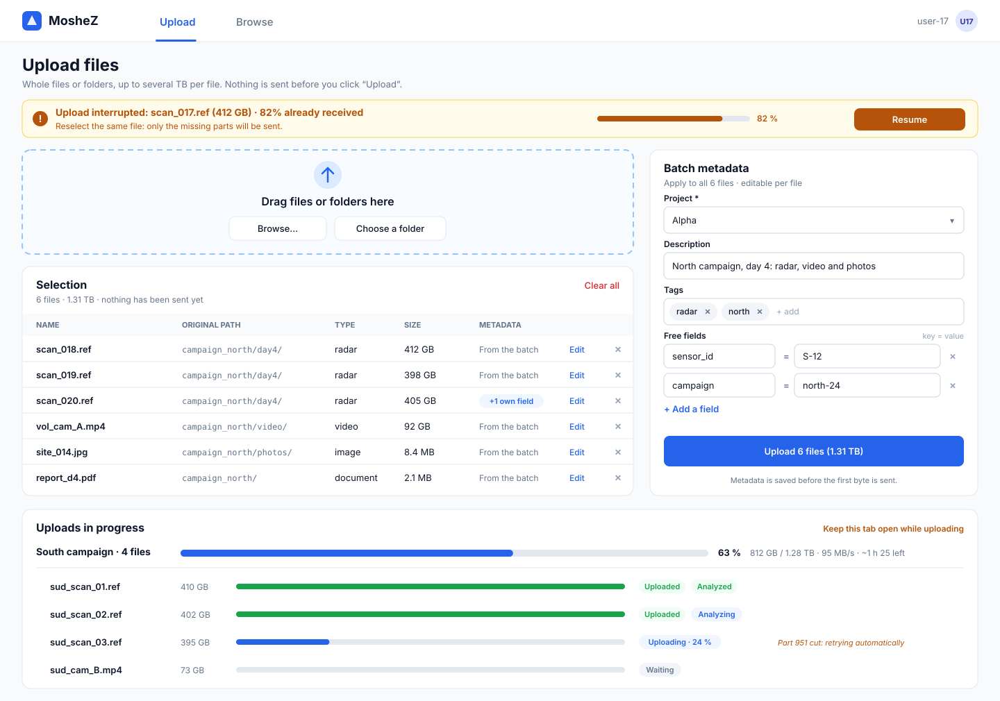
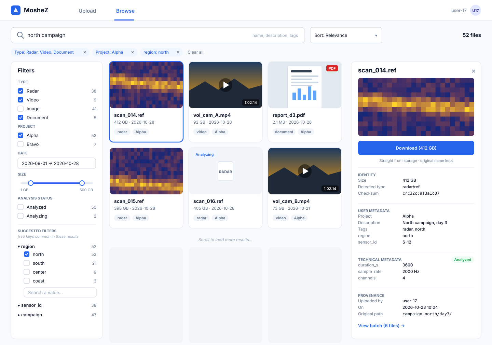

# Fullstack System Design: uploading and browsing terabyte-scale files

An architecture proposal for a system that lets users **upload** highly diverse files (documents, images, videos, radar files…), up to several TB per file, and **browse them in a logical way** through their metadata (entered by the user and extracted automatically).

> **The full detail** (assumptions, requirements, step-by-step end-to-end flows for upload and browse, crash cases) is in **[DESIGN_DETAILS.md](DESIGN_DETAILS.md)**.

**Contents:**
1. [Assumptions](#assumptions)
2. [Architecture overview](#architecture-overview): components, communication, where data lives
3. [Selected tools](#selected-tools), and why
4. [End-to-end flow: Upload](#end-to-end-flow-upload) and [Browse](#end-to-end-flow-browse): step by step, with the sequence diagrams
5. [Key decisions](#key-decisions), and why
6. [UI design of the Upload and Browse pages](#ui-design-of-the-upload-and-browse-pages): mockups and clickable prototypes

# Assumptions

1. The target storage exposes an S3-compatible API, whether it is in the cloud or on-prem.
2. The main flow is uploading new files through the UI. Existing data is imported by a server-side admin job that reuses the same processing pipeline.
3. "Logical browsing" means organizing by metadata, decoupled from the physical path.
4. Scale is measured in number of files and individual file size, more than in total volume.
5. The assignment does not mention access rights: every authenticated user sees every file. If needed, the API adds a mandatory access filter to every search, without changing the rest of the design.

*(The requirements and the decisions that follow from them are detailed in [DESIGN_DETAILS.md](DESIGN_DETAILS.md#requirements--decisions).)*

# Architecture overview

**The client is the user's web browser.** It runs the React application (Upload and Browse pages) and talks to only two parties: the API and the storage.

**The core principle:** the API is a **control plane**. It hands out authorizations (presigned URLs), keeps the registry and builds the searches, but **file bytes never go through it**. They go straight from the client to the storage, and back.

| Component | Role | Talks to | Holds |
|---|---|---|---|
| **Client: the web browser** (React + Uppy) | Runs the Upload and Browse pages. Splits and sends the files | API (JSON), storage (bytes, via presigned URLs) | Nothing persistent |
| **API** (FastAPI) | Authorizations, registry, search, cleanup and reconciliation jobs | Postgres, OpenSearch, Redis, storage (control operations) | Nothing (stateless) |
| **PostgreSQL** | Source of truth | — | Batches, files, statuses, user and technical metadata |
| **Redis Streams** | Task queue | — | The files to process, until they are processed |
| **Workers** (Python) | Type detection, metadata extraction, previews, indexing | Redis, Postgres, storage (partial reads), OpenSearch | Nothing (stateless) |
| **OpenSearch** | Search index | — | A copy of the metadata, rebuildable from Postgres |
| **Object storage** (S3 / GCS / MinIO) | The bytes | — | The originals (`files/`) and the previews (`previews/`) |

**Where data lives at each stage:**

| Stage | Where the data is |
|---|---|
| 1. File selection | **Client (browser)** only: references to the files and the entered metadata, in memory |
| 2. Click on "Upload" | **Postgres**: batch, file (`uploading`), user metadata, `uploadId`, fingerprint. **Storage**: an open multipart upload |
| 3. Sending the parts | **Storage**: the received parts, not assembled yet. Postgres knows which upload to resume |
| 4. End of upload | **Storage**: the assembled object (`files/{uuid}`). **Postgres**: `uploaded` + checksum. **Redis**: `{ file_id }` |
| 5. Processing | **Postgres**: technical metadata, `preview_key`. **Storage**: `previews/{uuid}.webp`. **OpenSearch**: the file's document. **Redis**: message deleted |
| 6. Browse | Nothing is written. The list is read from **OpenSearch**, the detail panel from **Postgres**, previews and bytes from the **storage** |

# Selected tools

| Need | Tool | Why | Rejected alternatives |
|---|---|---|---|
| Web client | **React + TypeScript** | Standard, typing helps with metadata, nothing to install for the user | Electron desktop app (to install and maintain) |
| Upload engine | **Uppy** (S3 multipart plugin) | Already implements multipart, presigned URLs, parallelism, retries and resume | Home-made, tus (bytes through a server), AWS SDK (credentials in the browser) |
| API | **Python + FastAPI** | Same language as the workers; asynchronous; automatic validation (Pydantic) and OpenAPI docs | Node/NestJS (two languages with the workers) |
| Source of truth | **PostgreSQL** (+ JSONB) | Mostly relational data, transactions for statuses, JSONB for the free-form part | MongoDB (flexibility not needed outside metadata, no foreign keys) |
| Search | **OpenSearch** | Text search, facets with counts, dynamic fields, in one request | Postgres alone (weak on dynamic facets); Elasticsearch (equivalent, licensing) |
| Task queue | **Redis Streams** | Open source, durable (AOF `always`), at-least-once, DLQ; pattern already proven | SQS (tied to AWS), RabbitMQ (nothing more here), Kafka (over-engineering) |
| Technical metadata | **ExifTool** (+ domain extractors) | Hundreds of formats, partial reads (`-fast`) | Apache Tika (reads the whole file) |
| Previews | **Pillow, PyMuPDF, ffmpeg...** | One rendering tool per format family, partial reads | — |
| Type detection | **libmagic** | Magic bytes, fallback for unknown formats | — |
| Storage | **S3 API** (S3, GCS, MinIO / Ceph) | A single implementation for cloud and on-prem | Storage event notifications (not portable) |

# End-to-end flow: Upload

1. **Selection (client).** The user drops files or a folder. The browser only keeps references to the files, in memory. Nothing is sent.
2. **Metadata (client).** The user enters the batch metadata (and, if needed, per-file metadata), then clicks "Upload".
3. **Registration (client → API → Postgres + storage).** For each file, the API creates its row in Postgres (status `uploading`, metadata, fingerprint) and opens a multipart upload on the storage. Metadata is therefore saved before the first byte.
4. **Sending the parts (client → storage).** The browser splits the file into parts (~100 MB). For each part, it asks the API for a presigned URL, then sends the part **straight to the storage**, several in parallel. The storage returns one ETag per part.
5. **If a crash happens.** The received parts stay in the storage. When the user comes back, they reselect the file, the API asks the storage which parts it already has (`ListParts`), and only the missing ones are sent.
6. **Completion (client → API → storage + Postgres + Redis).** The client sends the list of ETags. The storage assembles the object, the API sets the file to `uploaded` and puts `{ file_id }` into Redis. For the user, the upload is done.
7. **Processing (worker, asynchronous).** A worker takes the message, reads only the file header from the storage, extracts the technical metadata, generates a preview, updates Postgres and indexes the file in OpenSearch. In browse, the file goes from "Analyzing" to "Analyzed".
8. **Safety net (periodic jobs).** One job republishes files still waiting for processing and reindexes the ones that are behind. Another cancels abandoned uploads.

# End-to-end flow: Browse

1. **Search and filters (client → API → OpenSearch).** Every search, checked box or sort sends `GET /search`. The API builds an OpenSearch query, which returns the results, the total and the filter counts in one go.
2. **Previews (client → storage).** The API signs one URL per preview. The browser loads the thumbnails straight from the storage, only the ones visible on screen.
3. **Dynamic keys (client → API → OpenSearch).** When the user opens a suggested key (e.g. `region`), the browser asks for its values with their counts, then reruns the search with the chosen value.
4. **Detail panel (client → API → Postgres).** Clicking a result reads the file from Postgres, the source of truth.
5. **Download (client → API → storage).** The API answers with a redirect to a presigned URL, and the browser downloads the bytes straight from the storage, under the original name.

# Key decisions

1. **Direct upload to storage (presigned URLs).** The API never sees the bytes, so it is not a bottleneck, even for 1 TB. → [detail: API backend](DESIGN_DETAILS.md#2-api-backend)
2. **Multipart + resume without duplicated state.** Postgres knows *which* upload to resume, the storage knows *which parts* it received (`ListParts`). → [detail: requirement 1](DESIGN_DETAILS.md#1-uploads-need-to-be-reliable-and-support-terabytes-scale)
3. **User metadata saved before the first byte.** It is not lost on a crash, and errors are caught right away. → [detail: API backend](DESIGN_DETAILS.md#2-api-backend)
4. **Postgres = truth, OpenSearch = search copy.** Each tool does what it is good at, and the index can be rebuilt at any time. → [detail: database](DESIGN_DETAILS.md#3-database-postgresql--opensearch)
5. **Asynchronous, best-effort enrichment.** An unknown format or a failing extractor never makes an upload fail ("where possible"). → [detail: file processing](DESIGN_DETAILS.md#4-file-processing-redis-streams--workers)
6. **Never read a whole file.** Extractors and previews read only the headers, within a budget; integrity uses a combinable CRC32C rather than a SHA-256. → [detail: file processing](DESIGN_DETAILS.md#4-file-processing-redis-streams--workers)
7. **Reconciliation as a safety net.** Writing to two systems (Postgres + Redis, Postgres + OpenSearch) is never atomic: a job re-reads Postgres and catches up the gaps. → [detail: file processing](DESIGN_DETAILS.md#4-file-processing-redis-streams--workers)
8. **A user operation succeeds as soon as its durable part has succeeded.** A completed upload stays successful even if Redis is down. → [detail: file processing](DESIGN_DETAILS.md#4-file-processing-redis-streams--workers)
9. **Storage keys with no business meaning (UUID).** The logical organization lives in the metadata: nothing is ever copied to "tidy up". → [detail: object storage](DESIGN_DETAILS.md#5-object-storage)
10. **Browse reads only metadata and previews.** Tiering the originals is therefore risk-free, and search stays fast. → [detail: browse](DESIGN_DETAILS.md#browse-end-to-end-flow)

# UI design of the Upload and Browse pages

- **Mockups:** [docs/ui/upload-page.svg](docs/ui/upload-page.svg) and [docs/ui/browse-page.svg](docs/ui/browse-page.svg), shown below.
- **Clickable prototypes:** [docs/ui/upload.html](docs/ui/upload.html) and [docs/ui/browse.html](docs/ui/browse.html). Just open them in a browser, nothing to install.
- **How each element on screen maps to the architecture decision it illustrates** is detailed in [DESIGN_DETAILS.md](DESIGN_DETAILS.md#ui-design-of-the-upload-and-browse-pages).

## Upload page

## Browse page

---

**Going further:** assumptions, requirements, detailed end-to-end flows (client, API, database, processing, storage, search, download) and crash cases → **[DESIGN_DETAILS.md](DESIGN_DETAILS.md)**.
